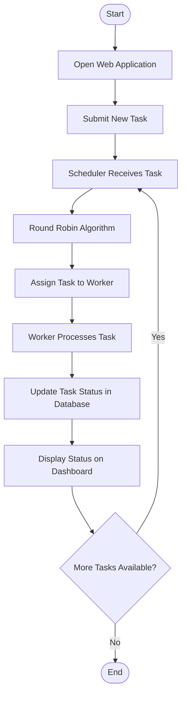
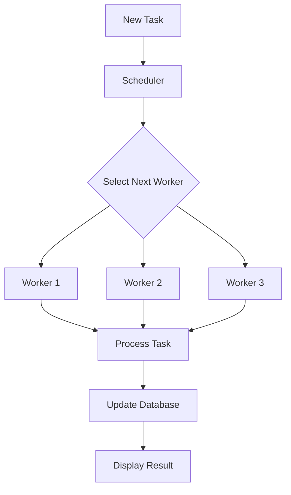

Task Scheduling System

### A Python-Based Task Allocation and Scheduling System Using Round Robin Algorithm

## 📌 Project Overview

Distributed Task Scheduling System is a Python-based mini project developed to manage and distribute multiple tasks among available workers efficiently.

The system uses the **Round Robin Scheduling Algorithm** to assign tasks to multiple worker threads in a sequential and balanced manner.

It provides a web-based dashboard where users can submit tasks, monitor task execution, and view worker status. The application demonstrates the basic concepts of distributed computing, task scheduling, workload distribution, and parallel processing.

## 🎯 Objectives

- To understand the fundamentals of distributed computing.
- To distribute tasks among multiple workers efficiently.
- To implement the Round Robin scheduling algorithm.
- To manage and monitor task execution.
- To demonstrate workload distribution and parallel processing.
- To provide a simple interface for task management.

## ✨ Key Features

- Task Creation and Submission
- Automatic Task Scheduling
- Round Robin Scheduling Algorithm
- Multiple Worker Thread Simulation
- Task Status Monitoring
- Pending and Completed Task Tracking
- SQLite Database Management
- User-Friendly Web Dashboard

## 🛠️ Technologies Used

| **Technology** | **Purpose** |
|---|---|
| Python | Core Programming Language |
| Flask | Web Application Framework |
| SQLite | Database Management |
| HTML | Web Page Structure |
| CSS | User Interface Styling |
| Threading | Multiple Worker Simulation |
| Round Robin | Task Scheduling Algorithm |

## ⚙️ Project Workflow

**Task Scheduling Process:**

1. Open the web application through the browser.
2. Enter and submit a new task.
3. The scheduler receives the submitted task.
4. The Round Robin algorithm selects the next worker.
5. The assigned worker processes the task.
6. The task status is updated in the database.
7. The dashboard displays the task and worker status.

## 🔀 System Flowchart

The following flowchart illustrates the overall working process of the Distributed Task Scheduling System.



## 🔄 Task Scheduling Flowchart

This flowchart explains how tasks are assigned to different workers using the Round Robin scheduling algorithm.



## 🔄 Round Robin Scheduling Algorithm

The project implements the **Round Robin Scheduling Algorithm** to distribute tasks among available workers in a circular order.

For example, if three workers are available:

- Task 1 → Worker 1
- Task 2 → Worker 2
- Task 3 → Worker 3
- Task 4 → Worker 1
- Task 5 → Worker 2

This approach helps distribute tasks across workers in a balanced sequence.

## 🚀 Installation and Execution

### Step 1: Clone the Repository

```bash
git clone https://github.com/lavanyapa76/Task-Scheduling-System.git
```

### Step 2: Open the Project Folder

```bash
cd Task-Scheduling-System
```

### Step 3: Create a Virtual Environment (Optional)

```bash
python -m venv venv
```

### Step 4: Install the Required Libraries

```bash
pip install -r requirements.txt
```

### Step 5: Run the Python Application

```bash
python app.py
```

### Step 6: Open in Browser

```text
http://127.0.0.1:5000
```

The task scheduling dashboard will open in your browser.

## 📊 Task Monitoring

The dashboard allows users to:

- Submit new tasks.
- View the list of submitted tasks.
- Monitor pending and completed tasks.
- Check worker activities.
- Observe automatic task distribution.
- Track task execution status.

## 🎓 Applications

- Task management systems.
- Workload distribution applications.
- Distributed computing concepts.
- Parallel task processing demonstrations.
- Worker-based task allocation systems.
- Academic learning and scheduling simulations.

## 🔮 Future Enhancements

- Support for workers on separate systems.
- Priority-based task scheduling.
- Implementation of advanced scheduling algorithms.
- Improved performance monitoring.
- Real-time task execution updates.
- Enhanced dashboard with analytics.

## 📚 Conclusion

The Distributed Task Scheduling System demonstrates the practical implementation of task scheduling and workload distribution using Python. By combining Flask, SQLite, multiple worker threads, and the Round Robin algorithm, the project provides an understanding of how tasks can be allocated and monitored efficiently in a distributed computing environment.
